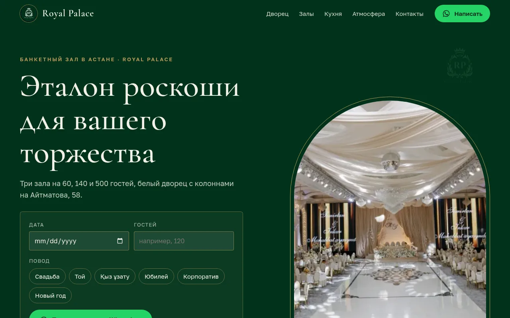

# Royal Palace — сайт зала торжеств

**Бизнес:** Royal Palace, зал торжеств в Астане.

## Задача
Одностраничный сайт зала: показать залы и кухню, ответить на главный вопрос клиента — подойдёт ли зал под число гостей — и привести человека в WhatsApp.

## Что сделано
- Блоки: дворец, залы (малый, средний, большой), кухня, фото, отзывы, как проходит бронь, контакты
- Форма «Свободна ли дата?»: дата, число гостей, повод. Подсвечивает подходящий зал и открывает WhatsApp с готовым текстом
- Полоса про Новый год над залами

## Стек
Astro 5, TypeScript, Tailwind CSS 4, шрифты Cormorant Garamond, Golos Text и Nunito (Fontsource). Деплой — Cloudflare Workers (статические файлы, Wrangler).

## Демо
https://royal-palace.a-a-studio.workers.dev

---
Сделано с помощью AI-инструментов (Cursor, AI-агенты) под моим руководством.
